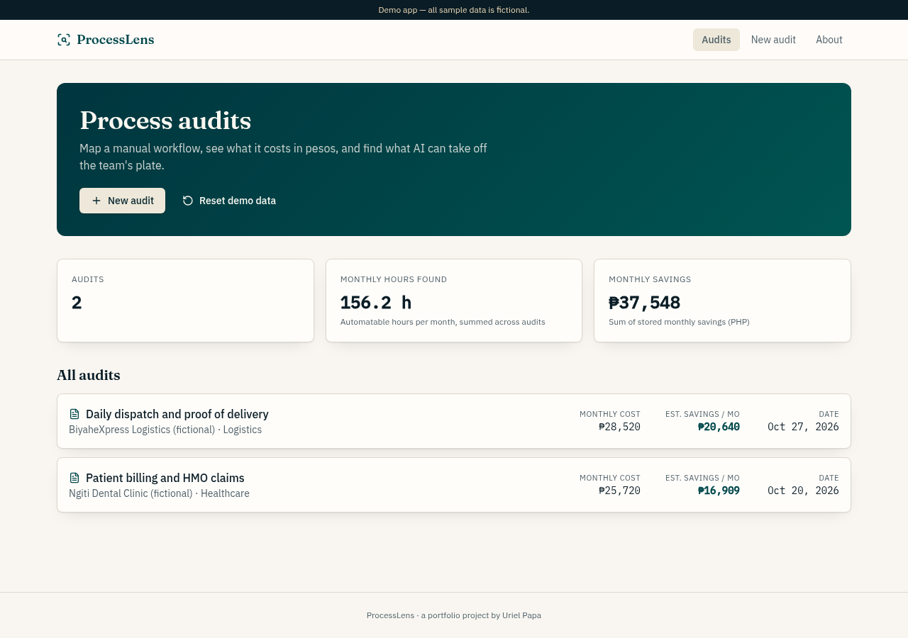
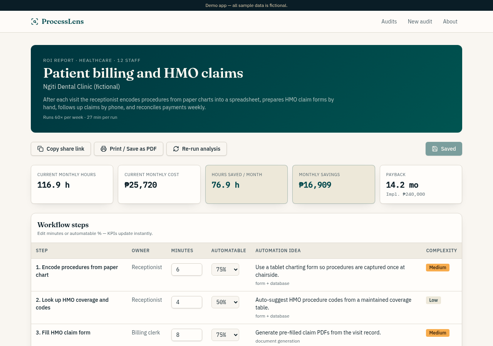
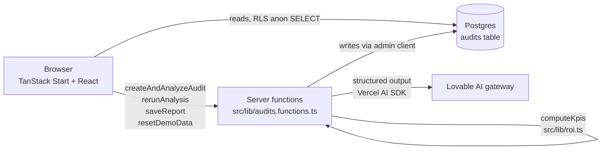

# ProcessLens

Turn a small business's manual workflow into a step map, a peso cost, and an ROI report with an implementation plan.

**Live demo:** https://processlens-uriel.lovable.app

Demo app. All sample data is fictional.



## The problem

Small businesses run core workflows by hand: billing, claims, dispatch, payroll. Owners rarely know how many staff hours these take each month or what that time costs. Without numbers, it is hard to decide what to automate first or whether the investment pays back.

## What it does

- **Audits (home):** lists every audit with monthly cost, estimated monthly savings and date. Portfolio KPIs on top: number of audits, automatable hours per month, total monthly savings (PHP).
- **New audit:** a 3-step guided intake (Business, Workflow, Review & analyze) with back/next and per-step validation.
- **AI analysis:** maps the described workflow into 4–10 ordered steps, plus 3–5 risks/assumptions and a 30/60/90-day plan.
- **Report (`/report/:id`):** KPI cards, an editable step table, a minutes-per-step bar chart (automatable vs. stays manual), risks, the plan, and an Assumptions box with editable hourly cost and complexity costs.
- **Live recompute and save:** editing minutes, automatable %, hourly cost or complexity costs updates every KPI immediately. Save persists the changes.
- **Share and print:** "Copy share link", "Print / Save as PDF" (print CSS), and "Re-run analysis".
- **Reset demo data** (with confirm) restores the two seeded audits. An **About** page explains the project.



## How it works

The AI does structuring, not arithmetic. The model reads the owner's free-text description and returns structured JSON (validated with a Zod schema): for each step, the owner, minutes per run, whether it is manual, an automatable share (0, 0.25, 0.5, 0.75 or 1), a one-sentence automation idea, a tool category and an implementation complexity (low/medium/high). It also returns risks and a 30/60/90-day plan.

All hours and money are computed deterministically in `src/lib/roi.ts` (`computeKpis`):

```text
monthly hours        = Σ step minutes × runs per week × 4.33 ÷ 60
monthly cost         = monthly hours × hourly cost
hours saved          = Σ (step minutes × automatable share) × runs per week × 4.33 ÷ 60
monthly savings      = hours saved × hourly cost
implementation cost  = Σ complexity cost of steps with automatable share > 0
                       (defaults: low ₱15,000 · medium ₱40,000 · high ₱90,000, editable)
payback (months)     = implementation cost ÷ monthly savings (1 decimal; n/a if savings = 0)
```

The same function produces the KPI columns stored on each audit, so the home totals match the reports.



- Reads go straight from the browser to the database under a read-only Row Level Security policy.
- All writes go through server functions in `src/lib/audits.functions.ts`. There are no anonymous write policies.
- AI errors (rate limit 429, credits 402, timeouts) are turned into friendly messages shown in the UI.
- Seed data lives in `src/lib/seed.ts`; the reset action reinserts from it.

## Data model

| Table | What it holds |
| --- | --- |
| `audits` | One row per audit: business inputs (name, industry, team size, hourly cost), workflow inputs (name, description, runs per week, roles, tools, pain points), the AI `analysis` (JSON: steps, risks, plan), editable `complexity_costs` (JSON), status, stored KPIs (`monthly_hours`, `monthly_cost`, `hours_saved`, `monthly_savings`) and timestamps. |

Schema: `drizzle/migrations/0000_create_audits.sql`.

## Quality and testing

Automated tests (`npm test`, Vitest):

- `src/lib/roi.test.ts`: unit tests for `computeKpis`: monthly hours, monthly cost, hours saved by automatable share, implementation cost counting only automatable steps, payback rounding, and payback = n/a when savings are 0.
- `src/test/app-routing.test.tsx`: checks that `/` matches a page route instead of falling back to not found.

Manual QA on the published app:

- Math hand-checked on a new audit ("Weekly payroll for a 25-person restaurant": 255 min/run → 18.4 h/month → ₱4,601; 12.1 h saved → ₱3,022/month) and on both seeded reports. All values matched the page.
- Reports at `/report/:id` are shareable and render on the server. Edits to steps, hourly cost or complexity costs recompute the KPIs live and survive a reload.
- Two seeded fictional audits: Ngiti Dental Clinic (patient billing and HMO claims) and BiyaheXpress Logistics (dispatch and proof of delivery).
- Found and fixed: a date hydration mismatch between server and browser (dates now use Asia/Manila time everywhere), and a copy-link fallback (`execCommand("copy")`) for browsers that block the Clipboard API.

## Tech stack

- **Frontend:** React 19, TanStack Router, TanStack Query, Tailwind CSS v4, Radix UI primitives, Recharts, lucide-react.
- **Server:** TanStack Start server functions (`createServerFn`), Zod for input and output validation, Vite.
- **Database:** Postgres via Lovable Cloud (Supabase), with Row Level Security.
- **AI:** Vercel AI SDK (`ai`, `@ai-sdk/openai`) pointed at the Lovable AI gateway, structured object output.
- **Hosting:** Lovable (edge runtime, Cloudflare Workers).
- **Tests:** Vitest, Testing Library.

## Run locally

Prerequisites: Node 22.

```sh
npm i
npm run dev
```

Environment variables (names only):

```text
SUPABASE_PROJECT_ID
SUPABASE_PUBLISHABLE_KEY
SUPABASE_URL
VITE_SUPABASE_PROJECT_ID
VITE_SUPABASE_PUBLISHABLE_KEY
VITE_SUPABASE_URL
```

Server-side, the app also uses `SUPABASE_SERVICE_ROLE_KEY` for writes and `LOVABLE_API_KEY` for AI calls. Both are provided by Lovable Cloud.

Note: AI calls use the Lovable AI gateway, which only works with Lovable Cloud. To run elsewhere, replace the provider setup in `runAnalysis` (`src/lib/audits.functions.ts`) with your own model provider key.

## Limitations and next steps

- Public demo with no login. Anyone can create, edit or reset audits. A real deployment would add accounts, per-team data isolation and role-based access.
- Step minutes and automatable shares are AI estimates. A real engagement would validate them with time studies or system logs.
- One flat hourly cost per audit. Next: per-role rates and one-time vs. recurring tool costs (licenses, AI usage) in the payback.
- Re-running an analysis replaces the previous one. Next: version history to compare analyses.
- Next: export to a branded PDF/DOCX proposal and a CRM integration for the discovery pipeline.

## Author

Uriel Papa. [GitHub](https://github.com/Edamuza) · [LinkedIn](https://www.linkedin.com/in/uriel-papa-vitese01/)

Built with Lovable (AI app builder) from a written spec, then tested against acceptance checks and fixed.
